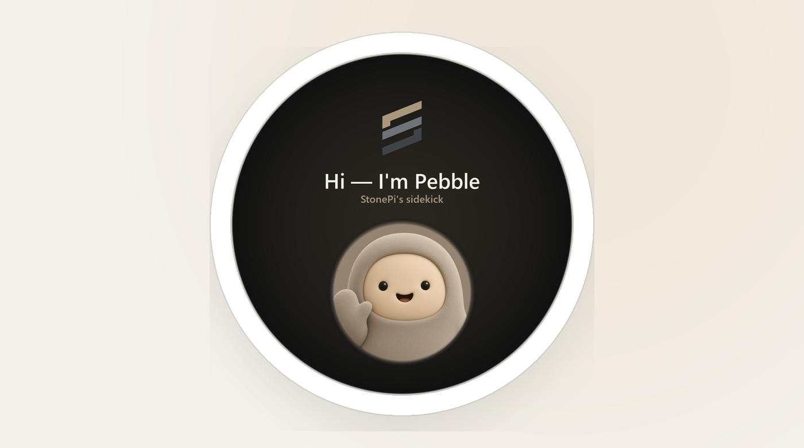

# Pebble firmware



ESP-IDF firmware for **Pebble** — StonePi’s pocket sidekick. It lives on the  
desk or in a bag: moods for home health and updates, voice when you want to  
talk to the Pi, soft sleep when you’re done. Hardware target is the Waveshare  
**ESP32-S3-Touch-AMOLED-1.75C** (32 MB flash — not the plain 1.75).

Talks to [StonePi](https://github.com/ast0ne1/stonePi) over [`PROTOCOL.md`](PROTOCOL.md)
v1 (`/agent/pebble/v1`). Pi-side AgentLink lives in that repo.

## Graphics

All bitmaps are baked for the **466×466** AMOLED — never scaled at runtime.
Pipeline matches [muse-gadget-sdk](https://github.com/facebookincubator/muse-gadget-sdk)
display plates:

1. Compose / crop at native size (`LANCZOS`)
2. Soft round vignette where needed (splash, home faces)
3. **4×4 Bayer dither → RGB565** (smooth gradients on 16-bit panels)
4. Emit LVGL `lv_image_dsc_t` C arrays under `main/assets/`

```bash
python tools/mkassets.py    # see tools/GRAPHICS.md for source layout
```

Do not call `lv_image_set_scale` / zoom on these plates. The PC sim always
streams full resolution.

## What this does (v1 shell)

- Friendly splash → home face + clock  
- Swipe / dots: home ↔ **Settings**  
- Settings → **Wi‑Fi**: scan, pick AP, password keyboard, join; NVS + reboot reconnect  
- Settings: **Pairing** (host + claim code), Sound, Sleep, Battery, Power off  
- **PROTOCOL.md v1** client: claim / ask / mood / config / unpair  
- Buttons (1.75C): **BOOT** hold = PTT (or short = toggle when Sidekick enables it); **PWR** short = home, hold ≈ soft sleep  
- Power: tickless idle + light sleep, real panel off, unused AXP2101 rails off  
(patterns from [curisama/The-Badge](https://github.com/curisama/The-Badge) — see `NOTICE`)

Wake word: Sidekick `talk.wake` → ESP-SR (“Hi ESP”; MultiNet for custom phrases when enabled).
Browser flash: [`flash/`](flash/) after `python tools/mkflash.py` (or `idf.py flash`).

## Pairing host

On the device: Settings → Pairing → set **Host** (empty until you type one):

| Target | Host field |
|---|---|
| StonePi on the LAN | `http://<Pi-IP>` (HTTP :80 — **no** `:8015`) |
| AgentLink on a PC (dev) | `http://<PC-LAN-IP>:8015` |
| Local protocol stub | `http://<PC-LAN-IP>:8014` — `python tools/pebble_stub.py --auto-claim 5` |

Contract: [`PROTOCOL.md`](PROTOCOL.md).

## PC simulator (no board, no ESP-IDF)

Same pattern as [The-Badge](https://github.com/curisama/The-Badge): real LVGL UI linked against `port_sim.c`, browser touches over WebSocket.

Needs **gcc** (mingw-w64 on Windows), **Python 3**, and `pip install pillow` (optional: `numpy` for faster tile diffs).

```bash
python sim/setup_sim.py          # once — clones LVGL 9.5 into sim/lvgl
python sim/build.py              # → sim/pebble_sim (.exe on Windows)
./sim/pebble_sim                 # screenshots → sim/shots/
PORT=8792 python sim/server.py   # open http://localhost:8792
```

On Windows PowerShell (xpack mingw at
`%USERPROFILE%\node_modules\@xpack-dev-tools\mingw-w64-gcc\.content\bin`):

```powershell
.\sim\build.ps1              # setup LVGL if needed + build pebble_sim.exe
.\sim\pebble_sim.exe         # PNGs → sim\shots\
.\sim\run_server.ps1         # then open http://localhost:8792
```

## Firmware build (board)

Needs **ESP-IDF 6.0.x** (tested on **6.0.1**) and the **1.75C** board — see
[`docs/SETUP.md`](docs/SETUP.md).

## Layout

```
main/          splash, shell, settings, wifi_ui, buttons, pairing, pebble_net, voice, wake
sim/           PC LVGL build + browser server (The-Badge pattern)
tools/         mkassets, pebble_stub, mkflash
flash/         WebSerial installer (after mkflash.py)
docs/          SETUP, AUDIO
PROTOCOL.md    v1 contract with StonePi / AgentLink
               (Pi side: https://github.com/ast0ne1/stonePi)
```
